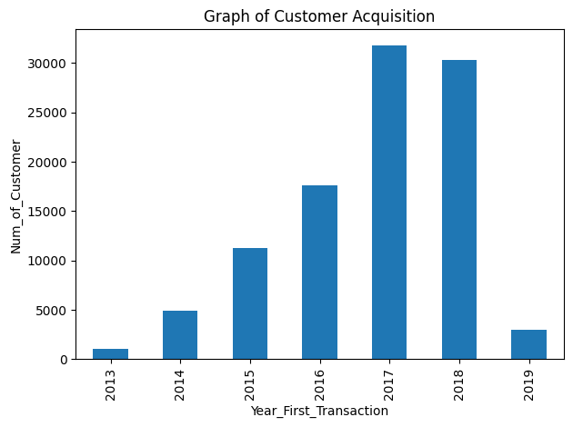
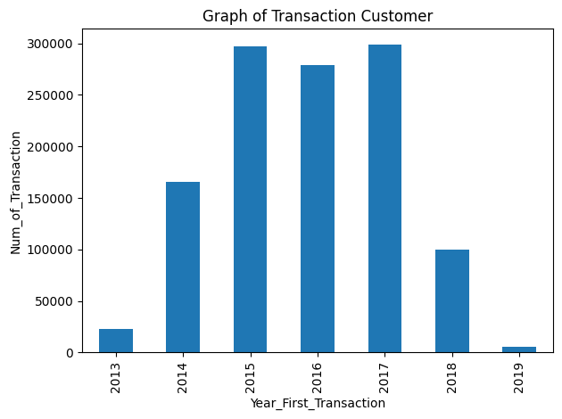
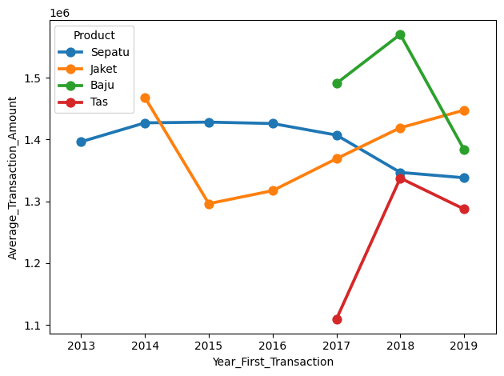
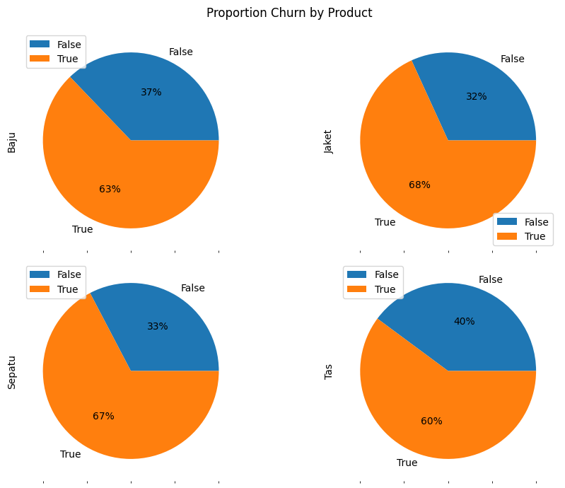
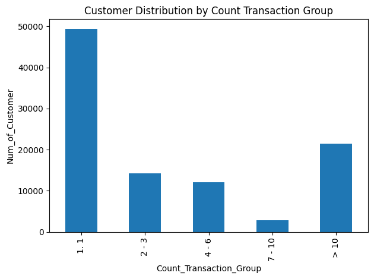

# Customer Churn Analysis — DQLab Sport Center

Analisis customer churn pada DQLab Sport Center menggunakan Python, Exploratory Data Analysis (EDA), data visualization, dan Machine Learning dengan Logistic Regression.

## 1. Background

DQLab Sport Center merupakan toko yang menjual berbagai kebutuhan olahraga, seperti jaket, baju, tas, dan sepatu. Toko ini telah beroperasi sejak tahun 2013 dan memiliki pelanggan tetap yang telah bertransaksi selama beberapa tahun.

Namun, pada awal tahun 2019, manajemen menghadapi permasalahan berupa penurunan jumlah pelanggan yang melakukan transaksi berulang (*repeat purchase*).

Tujuan analisis ini adalah mengidentifikasi pelanggan yang sudah tidak aktif bertransaksi, memahami pola transaksi pelanggan, serta membangun model prediktif yang dapat membantu perusahaan mengidentifikasi pelanggan yang berpotensi churn.

Dalam proyek ini, pelanggan dikategorikan sebagai **churn** apabila transaksi terakhirnya terjadi pada atau sebelum 1 Agustus 2018. Batas waktu tersebut digunakan berdasarkan definisi churn enam bulan terakhir dari update data yang tersedia.

Melalui analisis ini, diharapkan perusahaan dapat memperoleh insight mengenai perilaku pelanggan dan menyusun strategi retensi yang lebih tepat sasaran.

## 2. Objectives

Proyek ini memiliki beberapa tujuan utama:

- Melakukan data cleaning dan preprocessing terhadap data transaksi retail.
- Mengidentifikasi pelanggan yang berstatus churn dan non-churn.
- Menganalisis tren customer acquisition dari tahun ke tahun.
- Menganalisis tren jumlah transaksi dan rata-rata nilai transaksi berdasarkan produk.
- Memahami distribusi pelanggan berdasarkan frekuensi dan rata-rata nilai transaksi.
- Membangun model Machine Learning untuk memprediksi customer churn.
- Mengevaluasi performa model menggunakan confusion matrix, accuracy, precision, recall, dan F1-score.
- Menghasilkan rekomendasi bisnis untuk meningkatkan customer retention.

## 3. Dataset

Dataset yang digunakan adalah `data_retail.csv` yang disediakan oleh DQLab.

Dataset berisi 100.000 baris data dengan 8 kolom awal yang menggambarkan informasi pelanggan dan transaksi.

### Dataset Information

| Information | Description |
|---|---|
| Dataset | `data_retail.csv` |
| Total Rows | 100,000 |
| Total Columns | 8 |
| Unique Customers | 73,194 |
| Business Domain | Retail / Sports Equipment |
| Data Period | 2013–2019 |
| Data Source | DQLab |

### Dataset Features

| Column | Description |
|---|---|
| `no` | Nomor urut data |
| `Row_Num` | Nomor baris data |
| `Customer_ID` | Identitas unik pelanggan |
| `Product` | Produk yang dibeli pelanggan |
| `First_Transaction` | Tanggal transaksi pertama pelanggan |
| `Last_Transaction` | Tanggal transaksi terakhir pelanggan |
| `Average_Transaction_Amount` | Rata-rata nilai transaksi pelanggan |
| `Count_Transaction` | Jumlah transaksi pelanggan |

## 4. Tools

Tools dan library yang digunakan dalam proyek ini:
- Python
- Pandas
- NumPy
- Matplotlib
- Seaborn
- Scikit-learn

## 5. Project Workflow

Proyek ini dilakukan melalui beberapa tahapan:

1. Data Loading
2. Data Cleaning & Preprocessing
3. Churn Classification
4. Exploratory Data Analysis (EDA)
5. Data Visualization
6. Feature Engineering
7. Train-Test Split
8. Machine Learning Modeling
9. Model Evaluation
10. Business Insight & Prescriptive Analytics

## 6. Data Cleaning & Preprocessing

### 6.1 Data Loading

Dataset dimuat menggunakan Pandas dengan delimiter titik koma (`;`).

### 6.2 Data Type Conversion

Kolom `First_Transaction` dan `Last_Transaction` pada dataset awal masih berbentuk Unix timestamp dalam milidetik.

Kedua kolom tersebut dikonversi ke tipe data `datetime` agar dapat digunakan dalam analisis berbasis waktu.

```python
df['First_Transaction'] = pd.to_datetime(
    df['First_Transaction'] / 1000,
    unit='s',
    origin='1970-01-01'
)

df['Last_Transaction'] = pd.to_datetime(
    df['Last_Transaction'] / 1000,
    unit='s',
    origin='1970-01-01'
)
```

### 6.3 Identifying the Latest Transaction

Transaksi terakhir pada dataset digunakan untuk menentukan batas waktu klasifikasi churn.

Hasil pemeriksaan menunjukkan bahwa transaksi terakhir dalam dataset terjadi pada:

**1 Februari 2019**

```python
max(df['Last_Transaction'])
```

### 6.4 Customer Churn Classification

Berdasarkan definisi dari manajemen, pelanggan dikategorikan sebagai churn apabila transaksi terakhirnya terjadi pada atau sebelum 1 Agustus 2018.

```python
df.loc[
    df['Last_Transaction'] <= '2018-08-01',
    'is_churn'
] = 1

df.loc[
    df['Last_Transaction'] > '2018-08-01',
    'is_churn'
] = 0

df['is_churn'] = df['is_churn'].astype(int)
```

Keterangan:

| Value | Customer Status |
|---|---|
| `1` | Churn |
| `0` | Non-Churn |

### 6.5 Removing Unnecessary Columns

Kolom `no` dan `Row_Num` dihapus karena hanya berfungsi sebagai nomor urut dan tidak memberikan informasi yang relevan untuk analisis perilaku pelanggan.

```python
del df['no']
del df['Row_Num']
```

### Data Cleaning Summary

- Mengubah tipe data timestamp menjadi datetime.
- Membuat variabel target `is_churn`.
- Menghapus kolom yang tidak relevan.

## 7. Exploratory Data Analysis (EDA)

### 7.1 Customer Acquisition Trend

Analisis customer acquisition dilakukan untuk mengetahui tren jumlah pelanggan yang diperoleh berdasarkan tahun transaksi pertama.

Feature baru dibuat dari kolom `First_Transaction`:

```python
df['Year_First_Transaction'] = (
    df['First_Transaction'].dt.year
)
```



Insight:

- Jumlah data dengan tahun transaksi pertama terbanyak berada pada tahun 2017.
- Tren ini memberikan gambaran mengenai perkembangan customer acquisition dari tahun ke tahun.

*Catatan: Pada notebook, grafik ini menggunakan jumlah baris data yang dikelompokkan berdasarkan tahun transaksi pertama, bukan jumlah Customer_ID unik.*

### 7.2 Transaction Trend by Year

Analisis ini dilakukan untuk mengetahui jumlah transaksi berdasarkan tahun transaksi pertama pelanggan.



Insight:
Kelompok pelanggan yang pertama kali bertransaksi pada tahun 2015–2017 memberikan kontribusi transaksi tertinggi, dengan puncak pada tahun 2017 sebesar hampir 300.000 transaksi.

### 7.3 Average Transaction Amount by Product and Year

Analisis dilakukan untuk mengetahui tren rata-rata nilai transaksi berdasarkan produk dan tahun transaksi pertama.



Insight:

- Perubahan rata-rata nilai transaksi dari tahun ke tahun dapat digunakan untuk memahami perkembangan nilai transaksi pelanggan.
- Rata-rata nilai transaksi Sepatu cenderung stabil pada 2013–2016, kemudian menurun hingga 2019.
- Rata-rata nilai transaksi Jaket menurun tajam pada 2015, lalu meningkat konsisten hingga 2019, sementara Baju mencapai nilai tertinggi pada 2018 sebelum turun pada 2019.

### 7.4 Churn Proportion by Product

Analisis ini dilakukan untuk mengetahui proporsi pelanggan churn dan non-churn pada setiap produk.



Hasil proporsi churn berdasarkan produk:

| Product | Churn | Non-Churn |
|---|---:|---:|
| Jaket | 68.17% | 31.83% |
| Sepatu | 67.32% | 32.68% |
| Baju | 62.84% | 37.16% |
| Tas | 60.14% | 39.86% |

Insight:

- Jaket memiliki proporsi churn tertinggi, yaitu sekitar 68.17%.
- Sepatu juga memiliki proporsi churn yang relatif tinggi, yaitu sekitar 67.32%.
- Tas memiliki proporsi churn terendah di antara empat produk, yaitu sekitar 60.14%.
- Hasil ini dapat menjadi dasar untuk melakukan evaluasi strategi retensi berdasarkan kategori produk.

### 7.5 Customer Distribution by Count Transaction Group

Pelanggan dikelompokkan berdasarkan jumlah transaksi.

| Transaction Range | Category |
|---|---|
| Sampai dengan 1 | `1. 1` |
| 2–3 | `2. 2 - 3` |
| 4–6 | `3. 4 - 6` |
| 7–10 | `4. 7 - 10` |
| Lebih dari 10 | `5. > 10` |

Feature baru dibuat dengan nama `Count_Transaction_Group`.

```python
def func(row):
    if row['Count_Transaction'] == 1:
        return '1. 1'
    elif row['Count_Transaction'] <= 3:
        return '2. 2 - 3'
    elif row['Count_Transaction'] <= 6:
        return '3. 4 - 6'
    elif row['Count_Transaction'] <= 10:
        return '4. 7 - 10'
    else:
        return '5. > 10'

df['Count_Transaction_Group'] = df.apply(
    func,
    axis=1
)
```



Hasil distribusi:

| Transaction Group | Number of Records |
|---|---:|
| 1 | 49,255 |
| 2–3 | 14,272 |
| 4–6 | 12,126 |
| 7–10 | 2,890 |
| >10 | 21,457 |

Insight:

- Kelompok dengan jumlah transaksi satu kali memiliki jumlah data terbesar.
- Terdapat 49,255 baris data pada kelompok satu transaksi.
- Kelompok pelanggan dengan lebih dari 10 transaksi juga memiliki jumlah data yang cukup besar.
- Perusahaan dapat memanfaatkan informasi ini untuk membedakan strategi retensi pelanggan berdasarkan frekuensi transaksi.

### 7.6 Customer Distribution by Average Transaction Amount Group

Analisis ini dilakukan untuk mengetahui distribusi pelanggan berdasarkan rata-rata nilai transaksi.

Feature baru dibuat dengan nama `Average_Transaction_Amount_Group`.

| Average Transaction Amount | Category |
|---|---|
| 100,000–250,000 | `1. 100.000 - 250.000` |
| >250,000–500,000 | `2. >250.000 - 500.000` |
| >500,000–750,000 | `3. >500.000 - 750.000` |
| >750,000–1,000,000 | `4. >750.000 - 1.000.000` |
| >1,000,000–2,500,000 | `5. >1.000.000 - 2.500.000` |
| >2,500,000–5,000,000 | `6. >2.500.000 - 5.000.000` |
| >5,000,000–10,000,000 | `7. >5.000.000 - 10.000.000` |
| >10,000,000 | `8. >10.000.000` |

**Chart:** Customer Distribution by Average Transaction Amount Group


Insight:

- Kelompok rata-rata nilai transaksi 1,000,000–2,500,000 memiliki jumlah data terbanyak.
- Terdapat 32,819 baris data pada kelompok tersebut.
- Distribusi ini dapat digunakan untuk memahami karakteristik nilai transaksi pelanggan dan membantu menentukan strategi pemasaran berdasarkan nilai transaksi.

## 8. Feature Engineering

Sebelum membangun model Machine Learning, dilakukan feature engineering untuk menghasilkan fitur yang akan digunakan sebagai variabel independen.

### 8.1 Creating Year Difference

Feature `Year_Diff` dibuat dari selisih tahun transaksi terakhir dan tahun transaksi pertama.

```python
df['Year_Diff'] = (
    df['Year_Last_Transaction']
    - df['Year_First_Transaction']
)
```

### 8.2 Feature Columns

Fitur yang digunakan dalam model Logistic Regression:

| Feature | Description |
|---|---|
| `Average_Transaction_Amount` | Rata-rata nilai transaksi |
| `Count_Transaction` | Jumlah transaksi |
| `Year_Diff` | Selisih tahun transaksi pertama dan terakhir |

Variabel independen:

```python
feature_columns = [
    'Average_Transaction_Amount',
    'Count_Transaction',
    'Year_Diff'
]

X = df[feature_columns]
```

Variabel dependen:

```python
y = df['is_churn']
```

Target yang digunakan adalah status churn pelanggan.

## 9. Train-Test Split

Dataset dibagi menjadi data training dan data testing dengan proporsi 75:25.

```python
from sklearn.model_selection import train_test_split

X_train, X_test, y_train, y_test = train_test_split(
    X,
    y,
    test_size=0.25,
    random_state=0
)
```

Keterangan:

- 75% data digunakan untuk training.
- 25% data digunakan untuk testing.
- `random_state=0` digunakan agar pembagian data dapat direproduksi.

## 10. Machine Learning Modeling

Model yang digunakan adalah Logistic Regression.

Logistic Regression dipilih karena merupakan algoritma klasifikasi yang dapat digunakan untuk memprediksi status pelanggan ke dalam dua kategori, yaitu churn dan non-churn.

### 10.1 Model Initialization

```python
from sklearn.linear_model import LogisticRegression

logreg = LogisticRegression()
```

### 10.2 Model Training

Model dilatih menggunakan data training.

```python
logreg.fit(
    X_train,
    y_train
)
```

### 10.3 Model Prediction

Prediksi dilakukan terhadap data testing.

```python
y_pred = logreg.predict(X_test)
```

## 11. Model Evaluation

Evaluasi model dilakukan untuk mengukur kemampuan Logistic Regression dalam mengklasifikasikan pelanggan churn dan non-churn.

### 11.1 Confusion Matrix

Confusion matrix digunakan untuk membandingkan label aktual dengan hasil prediksi model.

```python
from sklearn.metrics import confusion_matrix

cnf_matrix = confusion_matrix(
    y_test,
    y_pred
)

print(cnf_matrix)
```

Hasil confusion matrix:

```text
[[ 3426  4905]
 [  994 15675]]
```

Visualisasi confusion matrix menggunakan Seaborn Heatmap.

**Chart:** Logistic Regression Confusion Matrix


Interpretasi:

| Actual / Predicted | Non-Churn (0) | Churn (1) |
|---|---:|---:|
| Non-Churn (0) | 3,426 | 4,905 |
| Churn (1) | 994 | 15,675 |

- True Negative (TN): 3,426
- False Positive (FP): 4,905
- False Negative (FN): 994
- True Positive (TP): 15,675

Model berhasil mengidentifikasi 15,675 pelanggan churn pada data testing, tetapi juga mengklasifikasikan 4,905 pelanggan non-churn sebagai churn.

### 11.2 Evaluation Metrics

Metrik evaluasi yang digunakan:

- Accuracy
- Precision
- Recall
- F1-Score

Hasil evaluasi Logistic Regression:

| Metric | Score |
|---|---:|
| Accuracy | 76.40% |
| Precision (Churn) | 76.17% |
| Recall (Churn) | 94.04% |
| F1-Score (Churn) | 84.16% |

Interpretasi:

**Accuracy — 76.40%**

Model berhasil memprediksi sekitar 76.40% dari keseluruhan data testing dengan benar.

**Precision — 76.17%**

Dari seluruh pelanggan yang diprediksi churn oleh model, sekitar 76.17% benar-benar termasuk pelanggan churn.

**Recall — 94.04%**

Model berhasil mengidentifikasi sekitar 94.04% pelanggan yang benar-benar churn pada data testing.

Recall yang tinggi menunjukkan bahwa model cukup baik dalam menangkap pelanggan churn, meskipun masih terdapat pelanggan non-churn yang salah diklasifikasikan sebagai churn.

**F1-Score — 84.16%**

F1-Score merupakan harmonic mean dari precision dan recall. Metrik ini digunakan untuk melihat keseimbangan antara precision dan recall.

### 11.3 Decision Tree Comparison

Selain Logistic Regression, model Decision Tree juga diuji sebagai pembanding.

| Metric | Logistic Regression | Decision Tree |
|---|---:|---:|
| Accuracy | 76.40% | 65.26% |
| Precision (Churn) | 76.17% | 74.00% |
| Recall (Churn) | 94.04% | 73.84% |
| F1-Score (Churn) | 84.16% | 73.92% |

Berdasarkan hasil evaluasi, Logistic Regression memiliki performa yang lebih baik dibandingkan Decision Tree default pada seluruh metrik yang dibandingkan.

Dengan demikian, Logistic Regression dipilih sebagai model yang lebih baik pada eksperimen ini.

## 12. Key Business Insights

Berdasarkan hasil analisis dan evaluasi model, beberapa insight yang diperoleh adalah:

### 12.1 Customer Churn Is a Significant Business Challenge

Sebanyak 66,569 dari 100,000 baris data dikategorikan sebagai churn.

Hal ini menunjukkan bahwa proporsi data dengan status churn cukup besar berdasarkan definisi churn yang digunakan.

### 12.2 Churn Proportion Differs Across Products

Produk Jaket memiliki proporsi churn tertinggi, yaitu 68.17%, diikuti Sepatu sebesar 67.32%.

Hal ini dapat menjadi dasar bagi perusahaan untuk melakukan evaluasi lebih lanjut terhadap strategi retensi pada kategori produk tersebut.

### 12.3 Transaction Frequency Can Support Customer Segmentation

Distribusi jumlah transaksi menunjukkan bahwa kelompok satu transaksi memiliki jumlah data terbesar.

Informasi frekuensi transaksi dapat digunakan untuk membedakan pelanggan dengan pola pembelian yang berbeda dan merancang strategi retensi yang sesuai.

### 12.4 Logistic Regression Can Support Churn Identification

Logistic Regression menghasilkan recall churn sebesar 94.04%.

Model ini dapat digunakan sebagai alat bantu untuk mengidentifikasi pelanggan yang berpotensi churn dan membantu perusahaan menentukan prioritas aktivitas retensi.

## 13. Prescriptive Analytics — Business Recommendations

Berdasarkan hasil analisis, berikut rekomendasi yang dapat diterapkan oleh DQLab Sport Center.

### 13.1 Targeted Retention Campaign

Pelanggan yang diprediksi churn dapat diprioritaskan untuk menerima kampanye retensi.

Contoh tindakan:

- Mengirimkan email atau pesan personal.
- Memberikan voucher pembelian.
- Menawarkan promo khusus untuk transaksi berikutnya.
- Mengingatkan pelanggan mengenai produk yang relevan.

### 13.2 Product-Based Retention Strategy

Karena Jaket dan Sepatu memiliki proporsi churn yang relatif tinggi, perusahaan dapat melakukan investigasi lebih lanjut terhadap kedua kategori tersebut.

Contoh tindakan:

- Mengevaluasi kualitas dan variasi produk.
- Menganalisis pola pembelian pelanggan.
- Mengidentifikasi alasan pelanggan tidak melakukan transaksi kembali.
- Menyusun program retensi berdasarkan kategori produk.

### 13.3 Customer Segmentation

Perusahaan dapat melakukan segmentasi berdasarkan:

- Frekuensi transaksi.
- Rata-rata nilai transaksi.
- Status churn.
- Kategori produk.

Segmentasi tersebut dapat membantu perusahaan menentukan prioritas pelanggan dan mengalokasikan anggaran pemasaran secara lebih efektif.

### 13.4 Win-Back Campaign

Pelanggan yang sudah lama tidak bertransaksi dapat menjadi target kampanye win-back.

Kampanye dapat berupa:

- Penawaran khusus untuk pelanggan lama.
- Voucher transaksi ulang.
- Rekomendasi produk.
- Program loyalitas pelanggan.

### 13.5 Retention Program Evaluation

Efektivitas program retensi perlu dievaluasi menggunakan metrik bisnis, seperti:

- Customer Retention Rate.
- Repeat Purchase Rate.
- Customer Lifetime Value.
- Campaign Conversion Rate.
- Retention Campaign Cost.

Evaluasi dapat dilakukan melalui eksperimen seperti A/B testing untuk mengetahui apakah program retensi benar-benar meningkatkan transaksi ulang.

## 14. Limitations & Future Improvements

Beberapa hal yang dapat dikembangkan dari proyek ini:

- Melakukan hyperparameter tuning pada Logistic Regression.
- Menggunakan StandardScaler untuk membantu proses optimasi model.
- Menguji algoritma Machine Learning lainnya.
- Melakukan threshold tuning berdasarkan kebutuhan bisnis.
- Melakukan customer segmentation yang lebih mendalam.
- Menggunakan temporal validation agar evaluasi model lebih realistis.
- Menghindari penggunaan fitur yang berpotensi menyebabkan data leakage.
- Mengevaluasi strategi retensi menggunakan A/B testing.

**Catatan metodologi:** Feature `Year_Diff` dihitung menggunakan tahun transaksi terakhir, sedangkan label churn juga ditentukan dari tanggal transaksi terakhir. Oleh karena itu, fitur tersebut berpotensi mengandung informasi yang berkaitan langsung dengan target. Untuk implementasi prediksi churn yang lebih realistis, fitur harus dibentuk hanya dari informasi yang tersedia pada tanggal prediksi, kemudian churn diamati pada periode setelahnya.

## 15. Conclusion

Proyek ini menunjukkan bagaimana data transaksi retail dapat digunakan untuk menganalisis customer churn dan membangun model prediktif menggunakan Machine Learning.

Melalui data cleaning, EDA, data visualization, feature engineering, dan Logistic Regression, diperoleh model dengan accuracy sebesar 76.40%, precision churn sebesar 76.17%, recall churn sebesar 94.04%, dan F1-Score sebesar 84.16%.

Logistic Regression memberikan hasil evaluasi yang lebih baik dibandingkan Decision Tree default pada eksperimen ini.

Hasil analisis dapat digunakan sebagai dasar untuk mengidentifikasi pelanggan yang berpotensi churn, memahami pola transaksi pelanggan, serta menyusun strategi retensi yang lebih terarah.

Namun, hasil model masih perlu dikembangkan lebih lanjut melalui validasi temporal dan evaluasi strategi retensi sebelum diterapkan dalam proses bisnis nyata.

## 16. Repository Structure

```text
dqlab-customer-churn-analysis/
│
├── README.md
├── dqlab_churn_analysis.ipynb
├── data/
│   └── data_retail.csv
│
└── images/
    ├── customer_acquisition_trend.png
    ├── transaction_trend_by_year.png
    ├── average_transaction_amount_by_product_year.png
    ├── churn_proportion_by_product.png
    ├── customer_distribution_by_count_transaction_group.png
    ├── customer_distribution_by_average_transaction_amount_group.png
    └── logistic_regression_confusion_matrix.png
```

## 17. Learning Outcomes

Melalui proyek ini, saya mempraktikkan kompetensi yang diperoleh dalam Data Analyst Career Track DQLab, antara lain:

- Menerapkan bahasa pemrograman Python untuk analisis data.
- Mengolah dataset menggunakan Pandas dan NumPy.
- Melakukan data cleaning dan preprocessing.
- Melakukan Exploratory Data Analysis (EDA).
- Membuat visualisasi data menggunakan Matplotlib dan Seaborn.
- Melakukan feature engineering.
- Membangun model Machine Learning menggunakan Scikit-learn.
- Mengevaluasi performa model klasifikasi.
- Menginterpretasikan hasil analisis untuk menghasilkan rekomendasi bisnis.

## Disclaimer

This project is intended for educational and portfolio purposes. The analysis and model results are based on the available dataset and should be validated before being applied to real business decisions.

Dataset source: DQLab.
